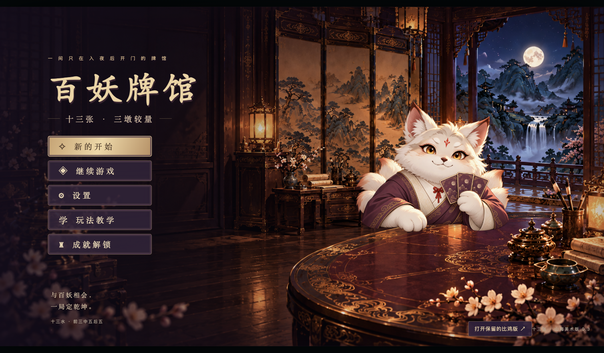
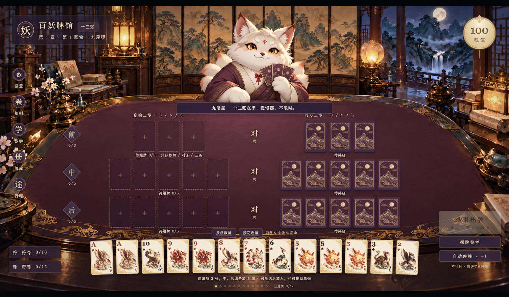

<div align="center">

# 百妖牌馆 · 十三张

**十三张牌，三墩取舍，一间只在入夜后开门的牌馆。**

山海经妖怪主题的单人扑克牌闯关原型，使用十三张／十三水的分墩玩法。

[](https://github.com/YEMIN11238/baiyao-card-house/actions/workflows/pages.yml)


**[开始试玩十三张](https://yemin11238.github.io/baiyao-card-house/game-thirteen/)** · [试玩保留的比鸡版](https://yemin11238.github.io/baiyao-card-house/game/) · [玩法与操作](game-thirteen/README.md)



</div>

## 先认识这张牌桌

每局拿到 13 张牌，分成前、中、后三墩，再与对手逐墩比较。把最强的牌放在后墩很容易，难的是给前墩和中墩也留下赢面。

| 墩位 | 张数 | 组牌范围 |
| :--- | :---: | :--- |
| 前墩 | **3** | 散牌、对子、三条 |
| 中墩 | **5** | 完整五张扑克牌型 |
| 后墩 | **5** | 完整五张扑克牌型 |

**摆牌必须满足「前墩 ≤ 中墩 ≤ 后墩」。** 前面比后面强叫倒墩，游戏会提示原因，并阻止开牌。前墩的三张顺子或同花不计为顺子、同花。

五张牌从弱到强是散牌、对子、两对、三条、顺子、同花、葫芦、四条、同花顺。本版每墩基础胜负为 ±3 魂值，平局为 0；特殊十三张、打枪和地方奖励番数暂未加入。详细判定见[规则说明](game-thirteen/README.md#基础规则)。

## 这一版可以玩什么

| 内容 | 当前实现 |
| :--- | :--- |
| **十三张摆牌** | 点击多选、拖放、交换、收回重排，支持点数与花色排序，思考不限时。 |
| **三种摆牌参考** | 兼顾三墩、优先前墩、做强后墩。查看免费，采用方案或自动理牌消耗 1 魂值；建议不保证赢牌。 |
| **8 种符令** | 查看部分对手手牌、换牌、调整点数与花色，以及改变本局输赢的效果。 |
| **8 件奇珍** | 围绕对子、顺子、同花、前后墩等条件提供持续收益。 |
| **商店与祭坛** | 用魂值购买、刷新商品，为指定牌附灵、刻印或祭拜。魂值同时用于消费与生存。 |
| **12 章、36 局** | 从 100 魂值出发，每章三局；魂值耗尽结束，存活完成 36 局通关。 |
| **6 位妖怪对手** | 九尾狐、鹿蜀、旋龟、天狗、狰、应龙依次登场，各有平静、得意与落败表情。 |
| **教学与存档** | 三步图示教学、逐墩结算明细、浏览器自动存档、成就与音量设置。 |

## 实机画面

### 一手牌，三种取舍

手牌、墩位、牌型和倒墩提示放在同一张桌面上。首次游玩可以先看教学，再用摆牌参考比较几种分法。



<table>
  <tr>
    <td width="50%"></td>
    <td width="50%"></td>
  </tr>
  <tr>
    <td align="center"><strong>局间整备</strong><br>买符令、收集奇珍，为下一局留下魂值。</td>
    <td align="center"><strong>山海来客</strong><br>每位对手负责两章，随局势切换表情。</td>
  </tr>
</table>

<details>
<summary><strong>看看三十六局之后的通关画面</strong></summary>


</details>

## 从入馆到下一局

**主菜单 → 教学与入场 → 发牌 → 摆成 3 / 5 / 5 → 逐墩揭牌 → 查看结算 → 商店与祭坛 → 下一局**

可随时打开规则、牌库和行程。关掉页面后，再从同一浏览器、同一地址进入，可以继续上次的牌局。

## 本地运行

准备 **Node.js 20 或更新版本**，无需安装第三方依赖。

```bash
git clone https://github.com/YEMIN11238/baiyao-card-house.git
cd baiyao-card-house/game-thirteen
npm start
```

打开 **[http://127.0.0.1:5174/](http://127.0.0.1:5174/)**。通过 `npm start` 启动时，保留终端窗口；按 `Ctrl+C` 停止服务。macOS 也可双击 `game-thirteen/启动十三张.command`，该脚本会在后台启动服务。

在 `game-thirteen/` 执行以下命令，可运行规则与流程测试：

```bash
npm test
```

测试覆盖牌型、倒墩、摆牌建议、实体牌守恒、符令、商店、祭坛、存档，以及完整 36 局和失败分支。

### 保留的比鸡版

原比鸡原型保存在 `game/`。另开终端，在该目录执行 `npm start`，访问 **[http://127.0.0.1:5173/](http://127.0.0.1:5173/)**；也可直接[在线试玩比鸡版](https://yemin11238.github.io/baiyao-card-house/game/)。

两版源码、默认端口和存档键独立。浏览器存档只保存在当前浏览器的对应地址中，在线版与本地版不会自动同步进度；本地游玩请持续使用相同地址与端口。

## 项目与素材

- [十三张玩法、操作与详细规则](game-thirteen/README.md)
- [美术方向与素材说明](docs/ART.md)
- [开发结构与运行说明](docs/DEVELOPMENT.md)
- [保留的比鸡版本](game/README.md)

画面采用绛紫、骨白、朱砂与旧金，以山海经妖怪作为角色和牌面题材。当前接入 **64 张 PNG 素材**，包括牌馆背景、牌面、角色表情、道具、结算装饰和胜负背景。位图素材使用 AI 图像生成工具，按统一美术方向生成并迭代；牌面点数、花色、文字与交互仍由游戏界面独立绘制。

## 当前进度

这是用于验证十三张闯关体验的**单人可玩原型**。目前已打通摆牌、结算、商店、祭坛、存档和完整通关流程，仍需继续试玩调整数值与难度。

界面以 1440 × 810 横屏为基准缩放，尚未制作手机竖屏布局；角色目前使用表情切换与短暂特效，尚未制作逐帧动画。音乐使用程序合成，正式音乐、Steam 客户端打包与 SDK 接入也尚未完成。
